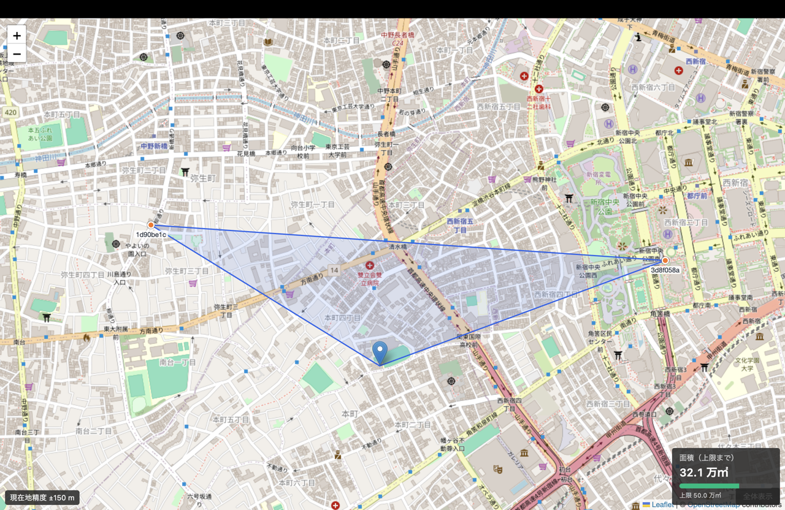
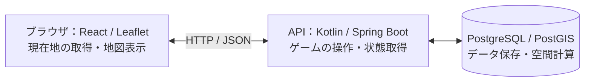

# topo（トポー）

**子どものころの探検のワクワクを、仲間との街歩きに。**

topoは、仲間と街を歩き、それぞれの位置を結んだ図形で地物を囲む探索ゲームです。囲んだ範囲にある地物の数がスコアになります。

例えば「0.5 km²以内の範囲で、できるだけ多くの神社を囲む」というお題なら、地図と面積を見ながら、どの方向へ歩き、どこで位置を確定するかを相談します。全員が確定すると、囲んだ範囲に神社がいくつあったかがわかります。

[公開版を開く](https://topo-web.onrender.com)



## 制作背景

小学生のころ、いつもの学区を少し越えて探検したときの楽しさが、制作の出発点です。

「こんな公園があったんだ」「ここに雰囲気のある神社がある」「こんなところにお墓がある」。いつもの行動範囲を出ると、思いもよらぬ景色や場所に出会います。「あの坂道を越えた先にも、街が広がっている」というワンダー、その発見のワクワクを、ゲームとして再現したいと考えました。

topoでは、実際に歩いて自分たちの図形をつくることを遊びの中心にしています。仲間と相談しながら歩くうちに、まだ知らない街へと足を延ばす。いつもの街でも、通ったことのない道に入り、「この場所に、こんなものがあったんだ」と気づく。知らない街を探検する楽しさと、知っている街を再発見する楽しさを、どちらも味わえるゲームを目指しています。

技術面では、もともと位置情報を扱うシステムに興味があり、R-treeのような空間インデックスを使ってみたいという動機もありました。街歩きのゲームを題材に、位置情報の取得・共有から、地理空間データの保存・計算・検索までを扱うことにしました。

## 遊び方

1. **ゲームをつくる。** 面積の上限と参加人数、スコアの対象となる地物を選びます。
2. **仲間を招待する。** 招待URLを共有し、全員が参加したら作成者がゲームを開始します。
3. **街を歩く。** 地図上で仲間の位置を見ながら、図形の面積が上限以内に収まるように移動します。
4. **位置を確定する。** ここだと思った場所で、自分の位置を確定します。
5. **結果を見る。** 全員が確定すると、囲んだ範囲の面積と、その中にあった地物の数がスコアとして表示されます。単位面積あたりにできるだけ多くの地物が収まる図形を見つけてみましょう！

※ここでいう図形とは、厳密にはプレイヤーの位置を外側から囲む多角形（凸包）です。3人の場合は三角形になります。

## 技術構成



| 領域 | 使用技術 |
| --- | --- |
| フロントエンド | React 19、TypeScript、Vite、Tailwind CSS v4 |
| 地図表示 | Leaflet、react-leaflet |
| バックエンド | Kotlin、Spring Boot、Spring Data JPA |
| データベース・地理空間処理 | PostgreSQL、PostGIS |
| スキーマ管理・データ投入 | Flyway、osm2pgsql |
| ローカルAPI・DB環境 | Docker Compose |
| API仕様 | OpenAPI、Swagger UI |
| テスト | JUnit 5、Spring Boot Test、Testcontainers、Vitest、Testing Library |
| 静的検査・整形 | ktlint、Biome、TypeScript |

## ローカルで動かす

### 前提環境

- DockerとDocker Compose
- Node.js 22.12以降（22系）とnpm
- 位置情報の利用を許可したブラウザ

APIはDocker内のJava 25でビルド・実行するため、起動だけならホストのJDKは不要です。ホストで `bootRun` やGradleのテスト・品質ゲートを実行する場合は、JDK 25を用意してください。

以下のコマンドはリポジトリのルートから実行します。API・DBとフロントエンドは、それぞれ別のターミナルで起動します。

### 1. DBとAPIを起動する

```bash
docker compose up --build
```

DBの接続準備ができてからAPIが起動し、Flywayがスキーマを適用します。APIは `http://localhost:8080`、DBはホストの5432番で接続できます。

### 2. フロントエンドを起動する

別のターミナルで実行します。

```bash
cd frontend
npm ci
npm run dev -- --port 5173 --strictPort
```

[http://localhost:5173](http://localhost:5173) を開き、ゲームを作成します。既定のAPI接続先は `http://localhost:8080` です。フロントの変更はViteで自動反映されます。ローカルでの位置取得は `localhost` で確認します。

### 3. 集計に使う地図データを投入する

スコアの集計には、OpenStreetMap（OSM）に登録された地物の位置データを使います。スキーマ作成とは別に、プレイする地域のデータの投入が必要です。取得・投入方法は [データ投入手順](docs/data-loading.md) を参照してください。APIの起動・再ビルドではデータを投入し直しません。

### APIの更新・ログ確認・停止

APIのソースを変更したら、リポジトリのルートで再ビルド・再作成します。

```bash
docker compose up -d --build api
```

`docker compose restart api` だけでは、ソースの変更は反映されません。

```bash
docker compose logs -f api
docker compose stop
```

停止・APIの再作成後もDBの名前付きボリュームとデータは維持されます。データを削除する操作は通常の停止手順に含めません。

### 8080番が使用中の場合

APIのホスト側ポートだけを変更できます。コンテナ内では8080番を使います。

```bash
API_PORT=18080 docker compose up --build
```

フロントも同じ接続先で起動します。

```bash
cd frontend
VITE_API_BASE_URL=http://localhost:18080 npm run dev -- --port 5173 --strictPort
```

この場合、Swagger UIも `http://localhost:18080/swagger-ui.html` で開きます。以後のCompose操作でも同じ `API_PORT` を指定してください。

### ホストのJDKでAPIを起動する場合

APIコンテナとホストのAPIを同じポートで同時に起動しないよう、先にAPIコンテナを停止します。

```bash
docker compose stop api
docker compose up -d db
./gradlew bootRun
```

DBだけDockerで起動し、既存どおりホストのJDK 25でAPIを実行できます。フロントの起動方法は同じです。

## API仕様の閲覧

APIの起動後、[Swagger UI](http://localhost:8080/swagger-ui.html) でAPI仕様を確認できます。

## 利用上の制約

- 認証・アカウント機能はありません。プレイヤーは発行されたIDで識別します。
- プレイ中の現在地はサーバーに送信・保存され、同じゲームの参加者に共有されます。
- スコアは投入したOSMデータの地域・取得時点・分類に依存します。現地にあるすべての場所が登録されているとは限りません。

## ライセンス・地図データ

コード・文書は [MIT License](LICENSE)。地図・神社データの出典・加工方法・利用条件は [データ投入手順](docs/data-loading.md) を参照してください。

アプリ内の「ライセンス・データ出典」から、同梱した依存ライブラリのライセンス本文を別タブで閲覧できます。生成・配布方法と収集範囲は [ライセンス・出典表示の説明](docs/license-notices.md) を参照してください。

## 関連資料

- [設計ドキュメント](docs/DESIGN.md)：ゲームの要件、構成、API・DBの設計
- [ユーザーストーリー](docs/story/STORY.md)：機能ごとの仕様への入口
- [データ投入手順](docs/data-loading.md)：OSMデータの取得・投入
- [Renderへの公開手順](docs/render-deployment.md)：初回配置、神社データの移送、通常更新と復旧
