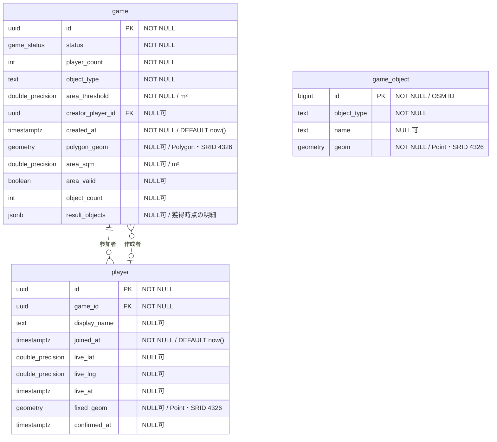

# DBのER図

ゲーム・プレイヤー・探索対象の保存構造と関連を確認するため、FlywayのSQLから物理スキーマを整理した。基準は [V1__init.sql](../src/main/resources/db/migration/V1__init.sql)、[V2__game_player.sql](../src/main/resources/db/migration/V2__game_player.sql)、[V3__game_result_objects.sql](../src/main/resources/db/migration/V3__game_result_objects.sql)。スキーマの変更時は、適用後の構造に合わせて本図を更新する。

## テーブルと関連

`PK` は主キー、`FK` は外部キー。`double_precision` はSQLの `DOUBLE PRECISION` を表す。図の関連数はDBの制約に基づく。

| 関連 | 外部キーと制約 |
| --- | --- |
| ゲームと参加者 | `player.game_id → game.id`。プレイヤーは必ず1ゲームに所属する。ゲームに対する参加者数の下限・上限はDBでは制約していないため、図では0人以上とする。 |
| ゲームと作成者 | `game.creator_player_id → player.id`。作成者はNULLを許容する。外部キー列にUNIQUE制約がないため、DB上は同じプレイヤーを複数ゲームの作成者にできる。 |

`game` と `player` は相互参照する。作成者の外部キーは `player` のテーブル作成後に追加される。DBの外部キーが保証するのはプレイヤーの存在であり、作成者がそのゲームに所属することまでは保証しない。

`game_object` はゲームに依存しない参照データで、他の2テーブルへの外部キーはない。ゲームとの対応は、対象種別と空間クエリで判定する。

最終確定時には獲得したID・種別・名前・座標を `game.result_objects` のJSONB配列へ複写し、元データの更新・削除から独立した結果として保存する。未完了はNULL、完了0件は空配列。項目の契約は [US-15](story/15.md) を参照する。

## 型とインデックス

- `game_status` はPostgreSQLのENUM型で、`WAITING`・`ACTIVE`・`COMPLETED`を取る。
- PostGISを使用する。位置の空間カラムはPoint、結果の多角形はPolygonで、いずれもSRID 4326。ライブ位置は `DOUBLE PRECISION` の緯度・経度と記録時刻で保持する。
- テーブル・カラムの必須性と既定値は図内に示す。ゲームの結果カラムとプレイヤーの確定カラムはNULLを許容する。

主キーに伴うインデックスに加え、SQLで次を定義している。

| インデックス名 | テーブル・列 | 方式 |
| --- | --- | --- |
| `idx_game_object_geom` | `game_object.geom` | GiST |
| `idx_game_object_type` | `game_object.object_type` | B-tree |
| `idx_player_game_id` | `player.game_id` | B-tree |

定員、作成時の人数下限、状態遷移などの業務ルールは、このER図の関連数やDB制約とは区別する。仕様は [DESIGN.md](DESIGN.md) と各ストーリーを参照する。
