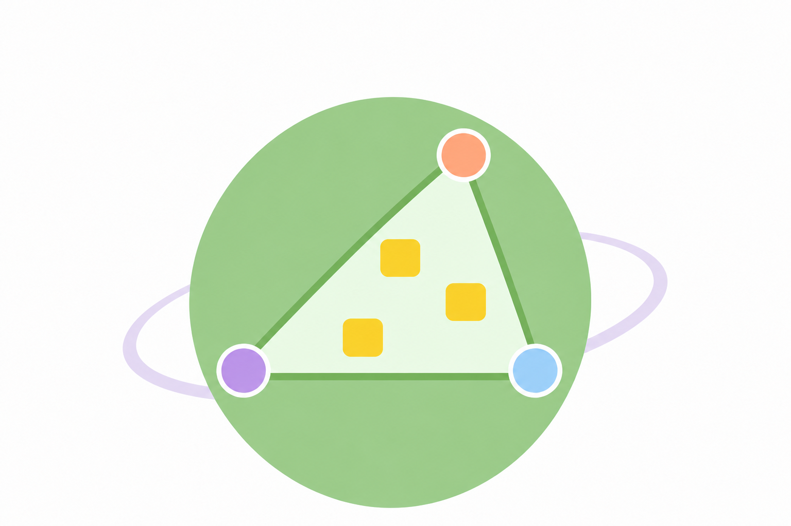

# 01-spec.md — US-19: 待機画面の目的説明と遊び方のウォークスルー

> 初めて遊ぶプレイヤーとして、待機画面の説明・図と、プレイ画面のウォークスルーでゲームの目的と操作を知り、後から読み直したい。
> 何を目指し、次に何を操作するか分かるようにするため。
> 本仕様は1実装単位（US-19）分。
>
> 状態：仕様・採用画像確定、実装・検証済み（2026-11-09）。初回実装の独立レビューは承認済み。利用者確認後の改訂は末尾の検証記録に記す。

## 1. 合意された仕様

現在の画面にはゲームの目的を説明する場所がない。待機中に目的を理解し、開始後に地図・面積メーター・確定ボタンの使い方を確認できるようにする。

体験の流れは、**待機画面で目的と図を見る → 初回の導入で目的と位置情報の扱いを読む →「次へ」でGPS取得を始める → 地図・面積・確定の説明を見る → 探索する**。以後は自動表示せず、プレイ画面の「遊び方」から開き直せる。

### 1.1 待機画面の目的説明と図

- 参加済みプレイヤーのWAITING画面に、作成者・参加者共通の説明を表示する。初回表示の記録に関係なく、待機画面では常に読める。
- 「仲間と街を歩き、面積の上限以内で、できるだけ多くの地物を囲む」という目的を短い文で伝える。「地物」は建物や施設などを指すと補足し、説明を神社に限定しない。面積の上限には、既存のゲーム状態にある `areaThreshold` をkm²へ換算して表示する。値は固定しない。待機画面・説明・面積メーター・結果は同じ単位とする。
- 3人の位置を表す点、その点で囲む三角形、地物を表す抽象的なマーカーを描いた模式図を添える。「3人で囲む例」と分かる表示にし、参加人数の設定に制約を加えない。図の対象は神社などの特定の種別に限定しない。
- 図には[作成済みの惑星の説明用画像](../../frontend/src/features/waiting-room/assets/game-purpose-little-planet-v3.png)を使う。惑星を背景に、3つの大きな丸をプレイヤーの位置、それらを結ぶ三角形を囲む範囲として描く。地物は同じ大きさ・形のソリッドな角丸四角に統一し、内部の点・穴・切り欠きは使わない。範囲内に黄色の地物を3個描く。
- 図の主題は「3人で範囲を囲み、その内側の地物を数える」。パステルカラーとシンプルな色面を使い、惑星の輪を背景のアクセントにする。卵・雲・範囲外の灰色アイコンは描かない。輪と三角形の境界を混同させない。実際の地図・座標・地物データを使わず、現在のプレイヤー位置や獲得数として表示しない。[編集プロンプト](../../frontend/src/features/waiting-room/assets/game-purpose-little-planet-v3.prompt.txt)を画像と同じ場所に保存する。
- 図には「丸はプレイヤーの位置、四角は地物。囲んだ範囲の内側の地物を数えます」と分かる短い説明を隣接させる。図が見えなくても、目的・位置と範囲の関係・集計対象が文章で理解できるようにする。面積上限はゲームの目的を伝える文で説明する。
- 全員が位置を確定すると、囲んだ範囲にある対象の地物の数が分かることも説明する。現在の獲得数は表示しない。目的・結果など複数の説明は `ul` / `li` の箇条書きにする。
- 既存の参加者一覧・招待URL・開始ボタンを維持する。作成者・定員による開始条件はUS-06のままとし、説明を読むことを開始条件にしない。
- 採用画像は `game-purpose-little-planet-v3.png`（1536×1024、PNG）で確定する。実装ではこの画像を使い、過去の比較案への差し替えや再生成は行わない。画面幅に合わせて縦横比を保って縮小し、プレイヤー・囲む範囲・地物が欠けるトリミングをしない。

**採用画像**

### 1.2 ウォークスルーの表示方法と内容

- React Joyrideの3系を使い、画面全体のオーバーレイと、説明対象を明るく強調する表示を行う。React 19対応・MITライセンスの版を採用する。
- 操作箇所を強調するステップは、実際に描画した地図・面積メーター・確定ボタンの領域に結び付ける。地図の説明中に測位できれば自分のマーカーを表示する。許可待ち・測位待ちでも説明を進められ、位置情報のダミーデータは使わない。
- 最初は特定の操作箇所を指さない導入として目的と位置情報の扱いを説明し、その後、地図・面積メーター・確定操作の順に案内する。

| 順序 | 対象 | 伝える内容 |
| --- | --- | --- |
| 1 | 導入 | 仲間と歩き、面積の上限以内でできるだけ多くの地物（建物や施設など）を囲む。現在地はサーバーに送信・保存され、同じゲームの参加者と共有される。「次へ」で取得を始め、必要なら位置情報の許可を選択する。周囲の安全を確かめて遊ぶ |
| 2 | 地図 | 仲間の位置と、みんなで囲む範囲を地図で見る。自分のマーカーは測位後に表示され、許可前・測位待ちでも説明を進められる。囲む範囲は3人以上の位置情報が揃ってから表示される |
| 3 | 面積メーター | 囲む範囲の面積と上限を確認し、移動する方向を相談する。3人以上の位置情報が揃うまでは、囲む範囲の面積が「未計測」と表示される |
| 4 | 確定ボタン | ここだと思った場所で確定する。確定後は変更できない。確定時の面積条件を満たさない場合は位置を調整して試し直す。全員が確定すると、囲んだ範囲にある対象の地物の数が分かる |

- 面積の条件はUS-13を正とする。現在面積の表示だけで「今回の確定が必ず成功・失敗する」と断言しない。現在面積と確定時の判定対象の違いを変える作業は本USに含めない。
- 待機画面と導入で伝える目的・上限を一致させる。MVPのデータ対象は神社のみだが、共通の遊び方は「地物」と表現する。正多角形スコアなどの追加要件は説明しない。
- 各ステップの複数の説明は `ul` / `li` の箇条書きにする。面積メーターは測位前後・説明中・通常時を通して右寄せを維持し、測位精度の表示有無によって左右に移動させない。
- 表の内容を満たす範囲で、短い見出し・文体・改行は実装時に調整してよい。

### 1.3 初回表示と位置取得の順序

- 作成者・参加者ともに、参加済みのACTIVE画面へ初めて入ったとき、自動で先頭から表示する。ACTIVEの参加済みURLへの直接再訪も対象とする。
- 導入の「次へ」を押すまでは `watchPosition` などのGPS取得とライブ位置送信を始めない。ブラウザで位置情報が既に許可済みでも同じ順序にする。
- 導入の「次へ」でGPS取得を開始し、必要に応じてブラウザの位置情報許可を求め、地図説明へ進む。測位でき次第マーカーを表示し、ライブ位置送信も始める。導入でスキップ・閉じる・Escを選んだ場合も通常のGPS取得を開始する。拒否・測位失敗・非安全コンテキストの扱いはUS-02に従い、拒否時も説明の終了操作を維持する。
- 導入から地図への遷移は初回説明の終了記録にしない。「戻る」で導入へ戻っても取得・送信は継続し、もう一度「次へ」を押してもwatchを追加登録しない。
- 待機画面ではGPS取得・ライブ位置送信を始めず、ウォークスルーも自動表示しない。
- 説明中も状態取得のポーリングは継続する。他のプレイヤーの操作を待たせる仕組みや、サーバー側のゲーム状態は追加しない。
- COMPLETEDを検知した場合は、説明を閉じてUS-14の結果画面を優先する。説明を閉じる処理を理由にGPS取得を開始しない。最初からCOMPLETEDの場合も説明を挟まず結果を表示する。

### 1.4 初回の記録と終了操作

- 初回の範囲は、同じオリジンを使う同じブラウザプロファイルとする。`localStorage` に完了・スキップ済みであることを保存し、ゲーム・プレイヤーごとの記録やサーバー保存は行わない。
- 「次へ」「戻る」「スキップ」を用意し、最終ステップの主ボタンは「探検を始める」とする。先頭では「戻る」を出さない。
- 完了、スキップ、閉じるボタン、Escでの終了は、いずれも意図的に説明を終えた操作として記録し、次回から自動表示しない。説明の外側をクリックしただけでは終了させない。
- 再読み込み・ページ離脱・結果画面への遷移など、本人の完了・スキップ操作によらない中断は記録しない。次の対象画面では先頭から表示し、途中ステップの保存・再開は行わない。
- 保存済みであれば、次のゲームでも自動表示せず通常のGPS取得を開始する。別ブラウザ・別端末・保存データ削除後は再表示される。
- 保存領域を利用できない場合もゲームを止めない。その画面滞在中はメモリ上で終了を保持して再表示を防ぐ。再訪時に再表示されることは許容する。
- 再描画・ポーリング・ウィンドウサイズ変更で説明を初期化したり、二重に起動したりしない。

### 1.5 再表示と操作・アクセシビリティ

- ACTIVEのプレイ画面に「遊び方」を置き、確定前・確定済みのどちらでも先頭から説明を開き直せるようにする。
- 手動での再表示は、既に開始したGPS取得・ライブ位置送信・ポーリングを止めたり、位置情報許可をやり直したりしない。
- 説明中は背景の地図操作・位置確定・その他の操作を実行できないようにする。強調された確定ボタンも操作できない。説明の操作だけが可能となるよう、Joyrideの対象要素への操作遮断も設定する。
- 未測位・確定済みなどでボタンが非活性でも、その領域を説明対象にできるようにする。説明のために確定ボタンを活性化しない。
- キーボードで次へ・戻る・スキップ・終了を操作でき、説明の表示中はフォーカスを説明内に留める。日本語の操作名・読み上げ名を設定する。
- 手動で開いた説明を閉じた後は「遊び方」にフォーカスを戻す。初回の終了後は「遊び方」など、プレイ画面内の操作できる要素へ移す。結果画面への遷移時は遷移後の画面に委ねる。
- 小さい画面でも説明文と操作ボタンを読める位置に収め、必要な場合は説明内をスクロールできるようにする。
- 対象要素が想定外に見つからない場合は、同じ説明を中央に表示するなどして終了操作を維持する。対象待ちのまま進めなくしたり、説明のためにダミーの位置を送信したりしない。

### 1.6 構成と既存機能の境界

- API・Domain・UseCase・DBスキーマは変更しない。既存GETの `areaThreshold` と画面状態を使う。図や説明のための追加APIは作らない。
- 待機画面の説明・図はDumbとし、Smartから面積上限を受け取る。初回判定・保存・GPS開始とJoyrideのライフサイクルはSmartまたはその専用hookで管理する。
- フォルダは機能単位とし、ウォークスルーのコンテナ・ビュー・専用hookを同居させる。API呼び出しはSmartに限る。
- US-02・US-07の起動順を本USの初回説明に合わせる。位置取得開始後の測位・送信間隔・エラー処理、US-05/06の参加・開始、US-14の結果遷移は維持する。
- プレイ中に目的を常設するミッションカードは追加しない。目的は待機画面とウォークスルーで伝える。ライセンス表示・手順書へのリンクはUS-18で扱う。

## 2. 受け入れ条件

### API・サーバー

- [x] 既存APIの入力・応答・ゲームルール・DBスキーマを変更せず、説明・閲覧済み記録のためのAPIを追加していない。

### フロント

- [x] 作成者・参加者の待機画面に、目的・そのゲームの面積上限・3人の例と分かる模式図が表示される。
- [x] 待機画面の既存の招待・参加者一覧・開始操作を維持し、説明の閲覧を開始条件にしていない。
- [x] 未閲覧のACTIVE画面で、Joyrideによる4段階の説明が自動表示され、地図・面積メーター・確定ボタンを順に強調する。
- [x] 位置の取得前に送信・保存・共有の説明を読め、導入の「次へ」または終了操作まではGPS取得もライブ位置送信も発生しない。
- [x] 未測位・未計測・確定ボタン非活性でも説明が進み、ダミーの位置・面積・獲得数を使わない。
- [x] 完了・スキップ・閉じる・Escの終了で記録され、同じブラウザの再訪・別ゲームで自動表示されない。
- [x] 再読み込みなどによる途中中断は終了記録にならず、次回は先頭から表示される。
- [x] 保存の読み書きに失敗しても、説明を終了して遊べる。ポーリングや再描画で再起動しない。
- [x] 導入の「次へ」でGPS取得が始まり、地図説明中に測位できればマーカーが表示される。許可拒否などの既存のエラー表示・再試行が維持される。
- [x] 「遊び方」で先頭から開き直せ、既存のGPS取得・送信・ポーリングを中断・二重起動しない。
- [x] 説明中は強調対象を含む背景操作が遮断され、位置確定が実行されない。
- [x] 説明中もポーリングが続き、COMPLETED検知時には説明を終了して結果画面へ進む。終了に伴うGPS取得は発生しない。
- [x] キーボード操作・フォーカス移動・日本語の読み上げ名と、小さい画面での可読性を満たす。
- [x] 図が見えない場合も目的が文章で分かり、現在面積の表示を根拠に確定成功・失敗を断言しない。
- [x] 図と隣接する説明で、丸がプレイヤー、四角が地物、三角形の内側が集計対象と分かる。地物アイコンは穴・内部の点のない同じ形に揃い、背景の装飾が説明の主題を妨げない。
- [x] 確定した採用画像を表示し、小さい画面でも縦横比を保ち、3つのプレイヤー位置・三角形・3つの地物を欠けなく表示する。

## 3. テスト観点

実装時の確認観点を記す。検証結果と実行範囲は下記「実装時の検証記録」を参照する。

- **フロント・結線** — GPS・API・保存領域を注入し、導入の表示中は未取得、「次へ」後は取得・送信開始、地図説明中にマーカー表示という順序を検証する。導入中の終了・保存済み再訪も区別する。
- **記録と再起動** — 導入の「次へ」は既読記録にならず、戻る・次へ・終了でもwatchを再登録しない。完了・スキップ・閉じる・Esc、途中の再マウント、保存例外、ポーリングによる再描画を区別する。
- **再表示と結果遷移** — 手動再表示時の測位・送信の継続、確定済み状態での再表示、COMPLETEDへの切り替え・COMPLETEDへの直接再訪を検証する。
- **目的説明** — 面積上限が異なるゲームで表示が変わり、図の内容を実際の位置・獲得数として扱わないことを確認する。図がなくても目的が読めることを確認する。
- **Joyrideの実表示** — 実ライブラリで未測位・未計測・非活性ボタンの強調、対象の欠落、背景・確定操作の遮断、フォーカス、小さい画面の表示を確認する。ライブラリをモックしたテストだけで操作遮断・配置を確認済みとしない。
- **配置・命名** — フロントのテストは `frontend/tests/` にsrcをミラーして置き、実ソースを `@/` からimportする。テスト名は `test_Action_Condition_Result` とする。
- **Domain / UseCase / Adapter** — サーバー側の機能追加はなく、説明専用のテストやDB起動は追加しない。

## 4. スコープ

### 含む

- 待機画面の目的・面積上限・模式図。
- React Joyrideの導入と4段階の説明、初回記録、スキップ・再表示。
- 導入で位置情報の扱いを説明してからGPS取得・送信を始める制御。
- 背景操作の遮断、フォーカス・読み上げ・小さい画面への対応、結果画面への遷移との整合。

### 含まない（他ストーリー / 将来）

- ライセンス表示・データ手順書へのリンク（US-18）。
- 獲得オブジェクトの詳細・結果地図への表示（US-15）。
- プレイ中の常設ミッションカード、参加前の画面・作成画面・結果画面をまたぐ操作ツアー。
- 位置情報の保存期間・削除方法、アカウント単位の閲覧記録、説明の閲覧状況のサーバー集計。
- 進行中の面積に確定座標を反映する変更、他プレイヤーの確定位置表示、既存の面積超過の警告表示の見直し（STORY.mdの課題メモ）。
- 正多角形スコア、位置・面積・スコアの計算、ゲームルールの変更。

### 判断ログ（3 Amigos）

| # | 論点 | 判断 | 理由 |
| --- | --- | --- | --- |
| D1 | 見せ方・ライブラリ | B。React Joyrideで実際の画面要素を順に強調する。 | 定番ライブラリを使い、操作する場所を直接示す。 |
| D2 | 自動表示と測位のタイミング | 改訂。初回の導入はGPS取得前に表示し、「次へ」で取得開始後、地図説明へ進む。 | 位置情報の扱いを先に伝え、地図の説明中にも自分のマーカーを確認できるようにする。 |
| D3 | 初回の範囲 | A。同じブラウザで一度。端末内に記録する。 | ゲームが変わっても共通のルールを繰り返し説明しない。 |
| D4 | スキップ・終了 | A。完了・スキップ・閉じるで次回の自動表示を止める。中断は記録しない。 | 本人の終了の意思を尊重し、必要な場合は手動で読み直せるようにする。 |
| D5 | 目的の表示場所 | 追加合意。ウォークスルーに加え、待機画面に目的と図を載せる。プレイ中の常設表示は追加しない。 | 開始前にゲームの目的を理解でき、初回説明では操作箇所との対応を確認できる。 |
| 図の作成 | 説明用画像 | 改訂。惑星の案を採用し、地物は内部の点・穴のない同じ角丸四角に統一する。3人の位置・囲む範囲・範囲内の地物の関係が分かる構図と隣接する説明文にする。指定された卵・雲・範囲外の灰色アイコンは削除する。 | 利用者が選んだパステルのシュールな世界観を残し、説明用画像として伝える内容を優先する。 |
| 最終合意 | 仕様・採用画像の確定 | 2026-11-09、利用者の承認により、削除指示を反映した惑星画像v3を含めて本仕様を確定する。 | 採用する画像と説明の意図を実装担当へ一意に引き継ぐ。 |
| 上流との整合 | 測位・参加・開始 | US-02/05/06/07に本USの担当範囲への参照を追記する。 | GPSの開始時点と待機画面の説明を一つの仕様で管理し、既存の参加・開始条件を変えない。 |

### 前提

- MVPの集計対象は神社のみ。面積条件はUS-13、結果遷移はUS-14に従う。
- 初回の導入中は自分の位置が未取得となる。地図説明に進んだ後も許可・測位待ちや他参加者の位置が不足する間は、マーカー・面積が表示されないことを許容する。
- React Joyrideの仕様は[導入手順](https://react-joyride.com/docs/getting-started)・[ステップ](https://react-joyride.com/docs/step)・[アクセシビリティ](https://react-joyride.com/docs/accessibility)を参照する。Escの既定動作に任せず、本仕様の終了操作に合わせる。

## 実装時の検証記録

2026-11-09、React Joyride 3.2.0で初回実装した。以下の初回検証は、説明終了後にGPSを開始する当時の仕様に対する記録。後の利用者合意により、導入の「次へ」から開始する仕様へ改訂した。最新の検証は末尾を参照する。

- 自動テストで初回GPS・送信の抑止、意図的な終了、保存例外、未完了の離脱、COMPLETED割込み、再表示中の送信・ポーリング継続を検証した。実Joyrideのステップ移動と欠落・非表示targetも検証した。
- Chromeで実コンポーネントと実Joyrideを操作し、320px / 390pxの表示、背景操作の遮断、Tab / Shift+Tab、Esc、終了時のフォーカス復帰、確定済みボタンの強調を確認した。待機画面の採用画像は縦横比を保ち、全体を表示する。
- ブラウザのGPS・APIは検証用に注入し、呼び出し回数を観測した。端末の実GPS・OSの許可ダイアログ・屋外の探索は今回の確認対象ではない。COMPLETED割込みでは結果がnullの検証データを使い、既存の結果取得失敗表示への遷移と、取得・送信・既読記録が発生しないことを確認した。
- Gradle build、フロントのlint・typecheck・全テスト・buildを実行した。独立レビューの判定は実装パイプラインのレビュー記録で管理する。

### 表示中の対象が失われる場合の追加検証（2026-11-09）

独立レビューで、地図の説明を表示した後に対象が消えるとJoyrideから欠落通知が出ず、説明操作が失われる条件が見つかった。現在の説明対象とその祖先の変化を検知し、同じステップを中央表示へ切り替える対応を追加した。

- 実Joyrideの自動テストで、2/4を表示した後の対象除去・非表示・祖先の非表示・対象属性の除去を確認した。初回の切り替えで既読記録・GPS開始・送信は発生しない。手動再表示中に初回位置許可拒否が届く場合も同じ説明と終了操作が残る。
- Chromeの320pxで対象除去、390pxで非表示と初回許可拒否を操作し、同じ説明の中央表示・終了操作・説明内フォーカスを確認した。中央表示中のCOMPLETED割込みでもGPS開始・既読記録は発生しない。位置許可拒否は検証用GPSのコールバックを注入し、OSの許可操作は行っていない。
- 修正後にGradle buildとフロントの4品質ゲートが成功した。フロントは29ファイル・210テスト成功。詳細と今回の証跡は実装パイプラインのround-2記録で管理する。

### 利用者確認後の文言・配置修正（2026-11-09）

目的と結果の説明を「地物」に揃え、未計測の対象を「囲む範囲の面積」と明記した。待機画面と各説明ステップは `ul` / `li` の箇条書きにした。測位精度の表示がない初回説明でも、面積メーターを通常時と同じ右寄せに固定した。

- フロントのlint・typecheck・29ファイル210テスト・buildが成功した。
- 実Joyrideと検証用GPSで、初回説明中の未測位状態と測位後の通常表示を比較し、面積メーターの位置が一致することを確認した。採用画像・位置取得の開始条件・ゲームルールは変更していない。
- この修正は初回実装の独立レビュー承認後に利用者の指示で行った。追加修正の独立レビューは実施していない。

### 表示単位と初回測位順の改訂（2026-11-09）

利用者の合意により、面積の表示をkm²に統一し、導入の「次へ」でGPS取得を開始する流れへ変更した。上限は固定値ではなくゲーム状態の `areaThreshold` を使い、500,000m²なら0.50 km²、2,000,000m²なら2.00 km²となる。APIのm²値と判定規則は維持する。

- 初回導入中はGPS・送信なし。「次へ」後は説明を開いたまま測位・送信が始まり、マーカーが表示される。導入へ戻る・再び次へ・終了でもwatchを再登録しない。導入から地図への移動では既読を記録しない。
- 自動テストで位置許可拒否後の説明と終了操作、地図説明中にCOMPLETEDへ遷移した場合のwatch解除と記録抑止を検証した。全29ファイル・218テスト、フロントのlint・typecheck・build、Gradle buildが成功した。
- Chromeで実Joyride・実Leafletと検証用GPS/APIを使い、導入中はwatch=0、地図説明2/4でwatch=1・マーカー1個・送信あり・既読なしを確認した。拒否時も2/4が中央に残り、閉じると既存の位置取得エラー画面に戻ることを確認した。OSの実際の許可ダイアログは今回操作していない。
- この改訂は利用者の追加指示であり、初回実装の独立レビュー対象に含まれない。検証記録と画面証跡は実装パイプラインの `us19/flow-unit-report.md` に記録した。
